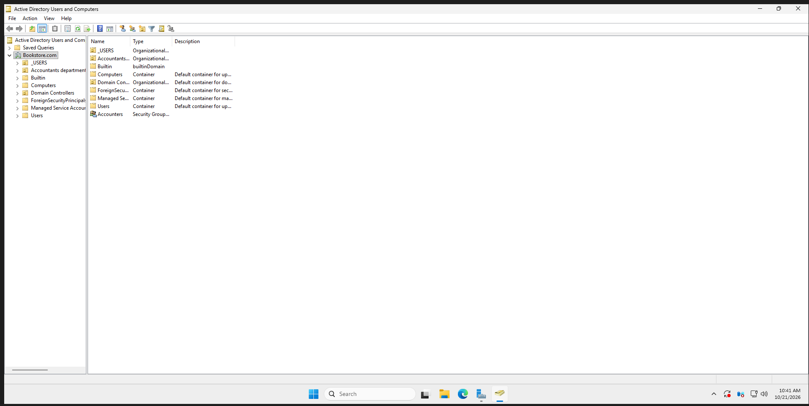
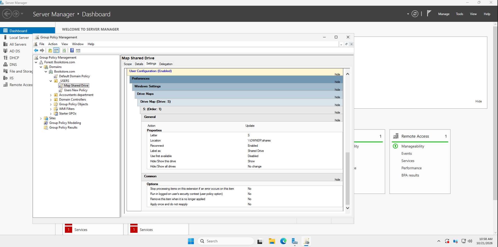

# Active Directory Configuration

## Overview
This section documents my Active Directory home lab configuration.

## Configuration
- Created Organizational Units (OUs)
- Created domain user accounts and security groups
- Joined Windows clients to the domain

## Purpose
Practice centralized user and computer management in a Windows Server environment.

## Evidence
### Active Directory Structure

Configured Active Directory in the Bookstore.com domain, including custom Organizational Units for users and the accounting department, and an accounting security group.

**Purpose:** Practice centralized management of users, groups, and organizational units in a Windows Server environment.

## Verification

Successfully deployed the network drive using Group Policy Preferences.

- Confirmed that the GPO was applied using `gpresult /r`.
- Verified that the domain user could see Shared Drive (S:) in File Explorer.

### Server-side GPO Configuration

### Client-side Verification

