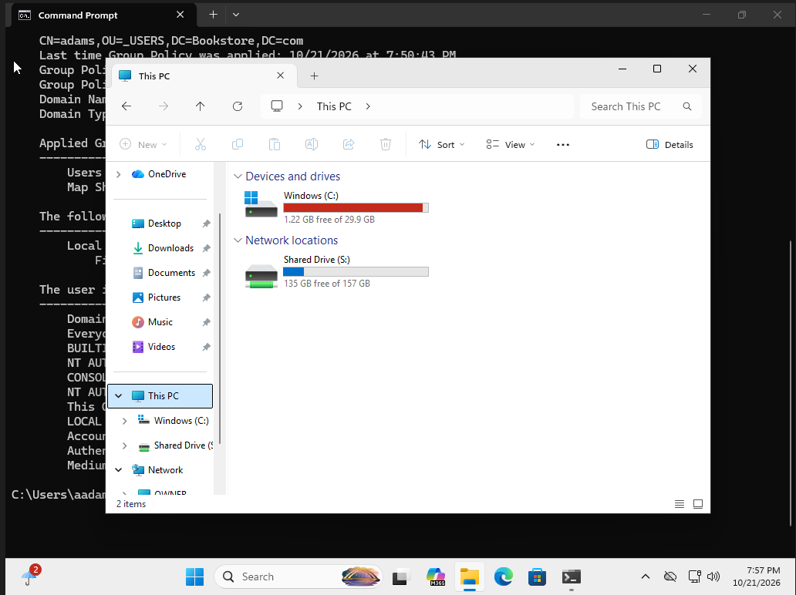

# Group Policy - Network Drive Mapping

## Overview
Configured automatic network drive mapping using Group Policy Preferences in a Windows Server Active Directory environment.

## Configuration
- Domain: Bookstore.com
- GPO: Map Shared Drive
- Linked OU: _USERS
- Drive letter: S:
- Network path: `\\OWNER\shares`
- Action: Update
- Reconnect: Enabled

## Verification
- Confirmed that the GPO was applied using `gpresult /r`.
- Verified that Shared Drive (S:) appeared in This PC on the domain-joined Windows client.

## Server-side Configuration

## Client-side Verification

## Purpose
Practice centralized deployment and troubleshooting of network drives in a domain environment.
