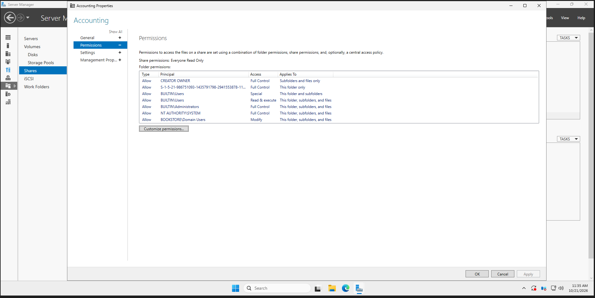
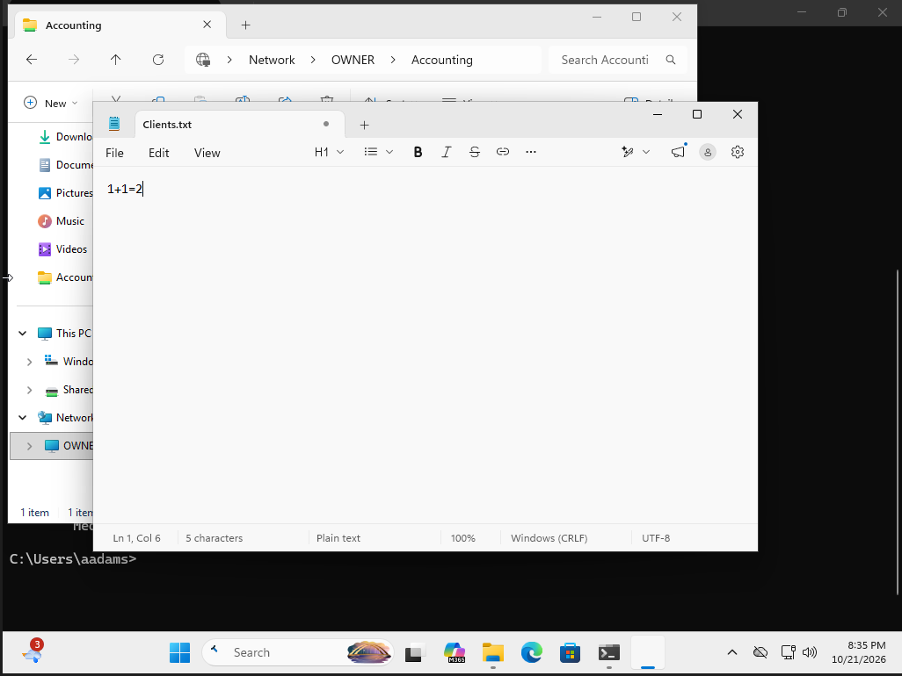

# SMB File Sharing Configuration

## Overview
Configured SMB file sharing on Windows Server to provide centralized access to files for domain users.

## Environment
- Windows Server
- Active Directory domain: Bookstore.com
- Windows client joined to the domain
- SMB network shares: `\\OWNER\Shares` and `\\OWNER\Accounting`

## Configuration
- Created shared folders on Windows Server
- Configured SMB share and NTFS permissions
- Configured network access for domain users
- Deployed the shared S: drive using Group Policy Preferences

## Permission Levels
- **Read:** View and open files
- **Modify:** Read, create, edit and delete files
- **Full Control:** Modify files and manage NTFS permissions

## SMB Share Permissions
The following screenshot shows the configured permissions for the Accounting share.

## Client-side Verification
Successfully accessed `\\OWNER\Accounting` using the domain user `adams`.

- Opened `Clients.txt`
- Edited the file from the Windows client
- Confirmed previously saved changes persisted after reopening

## Group Policy Verification
- Confirmed GPO application using `gpresult /r`
- Verified that Shared Drive (S:) appeared in File Explorer

## Troubleshooting Note
The Accounting share displays Everyone: Read Only at the SMB level, while file modifications were observed. Effective write permissions require further investigation.

## Purpose
Practice Windows Server administration, SMB file sharing, NTFS permissions, Group Policy and troubleshooting.
